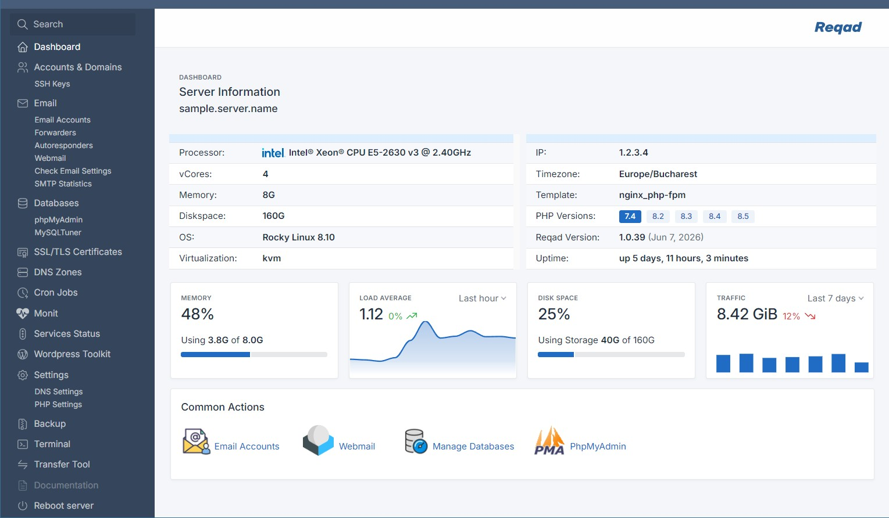

# Reqad - the alternate hosting control panel

[](LICENSE)
[](https://www.reqad.com/)
[](https://www.reqad.com/)

**Open source & self-hosted.** Reqad is a free control panel for Rocky Linux, AlmaLinux
and RHEL - manage hosting, email, DNS, SSL, WordPress and multiple PHP versions from one
clean dashboard.

Easy to use, with no license fees. Built for running your own domains or client sites
on a single VPS, with predictable costs.



## Features

- **Hosting accounts** - per-domain accounts with disk-usage monitoring
- **Email** - Exim + Dovecot + Roundcube webmail + SpamAssassin, with SPF, DKIM, SRS,
  forwarders and autoresponders
- **WordPress toolkit** - install, one-click login, page cache, security hardening and
  PageSpeed scores per site ([details below](#wordpress-toolkit))
- **Multiple PHP versions** - per-account PHP 7.x/8.x with OPcache, APCu and a full
  `php.ini` editor
- **SSL/TLS** - Let's Encrypt & ACME certificates for the panel and every hosted domain
- **DNS management** - Cloudflare, cPanel and PowerDNS providers, with wildcard support
- **Databases** - MySQL/MariaDB with phpMyAdmin
- **cPanel migration** - import existing accounts with domains, mail and databases
- **File manager** - account-level, with CodeMirror editor, bulk operations, chmod and
  archive support
- **More tools** - browser terminal, SSH keys, cron jobs, backups and service control

### WordPress toolkit


Each WordPress site gets its own management page:

- **Install and discover** - one-click install with the database created automatically.
  A rescan finds existing installs, including ones in subfolders.
- **One-click login** - opens wp-admin straight from the panel.
- **Site overview** - WordPress, PHP and theme versions, pending plugin updates, disk
  usage, SSL status and the login URL.
- **Screenshot and PageSpeed** - a site screenshot plus Google PageSpeed scores for
  performance, accessibility, best practices and SEO.
- **Performance** - Nginx page cache, a real system cron in place of WP-Cron, a
  search-engine indexing switch, and a maintenance mode that returns HTTP 503 so search
  engines come back later.
- **Security hardening** - per-site switches with recommended defaults:
  - **Web server rules:** block `xmlrpc.php`, `wp-config.php`, sensitive files and author
    scans; forbid PHP in `wp-includes`, uploads and cache directories; add security
    headers; block aggressive crawlers; allow logins only from listed IPs.
  - **WordPress settings:** hide the WordPress version, disable dashboard file editing,
    turn off pingbacks, move the login to a custom URL.
  - **Files:** regenerate the security keys and restrict file permissions.

#### Page cache and the Reqad Cache Purger plugin

On Nginx servers, turning on **Nginx cache** serves pages straight from a FastCGI
cache, without running PHP for anonymous visitors. Logged-in users, the cart, checkout
and wp-admin are never cached.

Reqad also installs its companion WordPress plugin,
[**Reqad Cache Purger**](https://github.com/wbdv/reqad-cache-purger). The plugin clears
the cache automatically when content is published, updated, trashed or deleted. It also
adds a purge button to the admin bar, an optional cache warmer and a cache self-test.

## Demo

Try Reqad without installing anything - a live demo panel is available at
[reqad.com/demo](https://reqad.com/demo).

## Requirements

- **OS:** Rocky Linux, AlmaLinux or RHEL 8 / 9 - a fresh, clean install
- **Architecture:** x86_64
- **Memory:** 1 GB RAM minimum, 2 GB or more recommended
- **Access:** root over SSH
- **Hostname:** a fully qualified name (e.g. `srv1.example.com`) with a DNS A record
  pointing to the server - see [Step 2](#step-2---hostname-and-reverse-dns)
- **A free reqad.com account with the server's IP added** - needed before you install,
  see [Step 1](#step-1---register-and-add-your-servers-ip)

**Stack it manages:** Nginx / Apache · MariaDB · Exim / Dovecot · PHP / Roundcube ·
PowerDNS / Cloudflare · Let's Encrypt · WordPress · Monit · CSF firewall.

## Installation

Installing takes three steps, in this order:

1. [Register and add your server's IP](#step-1---register-and-add-your-servers-ip) at reqad.com
2. [Set the hostname and reverse DNS](#step-2---hostname-and-reverse-dns)
3. [Run the installer](#step-3---install)

### Step 1 - Register and add your server's IP

> **Do this first.** Reqad is in early access and its package repository
> (`repo.reqad.net`) only answers servers whose IP address is on the allow-list. Until
> your server's IP is added, the install command fails and opening the `install.sh` link
> in a browser asks you to sign in. That is expected; it is not a bug.

1. **Register** a free account at [reqad.com](https://www.reqad.com/#signup) and confirm
   your email address.
2. **Add your server's public IP** on your [account page](https://www.reqad.com/account).
   If you don't know the IP, run this on the server:

   ```bash
   curl -4 ifconfig.me
   ```

3. **Wait a minute or two.** The IP is allow-listed shortly after you add it; then the
   installer can reach the repository.

See [reqad.com/download](https://www.reqad.com/download) for the same steps.

### Step 2 - Hostname and reverse DNS

Set the server's hostname before you install. Reqad needs a fully qualified name that
resolves in public DNS to the server's IP address: the panel is reached at that name and
its Let's Encrypt certificate is made for it. `localhost`, single words like `myvps` and
local-only names (`.local`, `.localdomain`) can't be used.

```bash
hostnamectl set-hostname srv1.example.com
host srv1.example.com     # must show the server's public IP
host 203.0.113.10         # reverse DNS of the IP - should show srv1.example.com
```

- **A record:** create it at your DNS provider, `srv1.example.com` → the server's IP.
- **Reverse DNS (PTR):** set it in your hosting provider's control panel, to the same
  name. If the hostname can't be used, the installer takes the reverse DNS name instead,
  as long as that name passes the same check. If you install the mail stack, a matching
  PTR also helps your mail get delivered, since many mail servers check it.

If the hostname doesn't pass, the installer stops at the start, before installing Reqad,
and tells you what to fix. Behind NAT the name may point to a public address the server
doesn't see itself: the installer only warns about that, and the certificate for the name
works as long as ports 80 and 443 on that address reach the server.

### Step 3 - Install

Once your server's IP is allow-listed ([Step 1](#step-1---register-and-add-your-servers-ip)),
run one command on a fresh EL8 or EL9 server - the same command for both, it detects which
one you are on:

```bash
bash <(curl -sSL https://repo.reqad.net/install.sh)
```

It checks the server, then opens a terminal UI to choose the web server, PHP version,
whether to install the mail stack, the SSH port and the timezone:

```
┌──────────────────────────────────────────────────────────┐
│ Rocky Linux 9.4 (Blue Onyx) · x86_64                     │
│ srv1.example.com   203.0.113.10   4 vCPU   7.8G RAM      │
├──────────────────────────────────────────────────────────┤
│ ▸ Web server    [ nginx + php-fpm ] [ apache + mod_php ] │
│   PHP version   [ 7.4 ] [ 8.2 ] [ 8.3 ] [ 8.4 ] [ 8.5 ]  │
│   Email stack   [ no ] [ yes ]                           │
│   SSH port      22                                       │
│   Timezone      Europe/Bucharest                         │
├──────────────────────────────────────────────────────────┤
│                    Start installation                    │
└──────────────────────────────────────────────────────────┘
  ↑↓ move · ←→ change · ⏎ select · q quit
```

Pick **Start installation** and it sets up the web stack, MariaDB, SSL and - if you asked
for it - the mail stack. A log of the run is kept at
`/var/tmp/reqad-install/install_reqad.log`.

### Unattended

Pass any option and the UI is skipped, using the defaults for anything you leave out:

```bash
bash <(curl -sSL https://repo.reqad.net/install.sh) \
  --template nginx_php-fpm \
  --php 8.4 \
  --email \
  --ssh-port 1922 \
  --timezone 'Europe/Bucharest'
```

| Option | Default | What it does |
| --- | --- | --- |
| `--template` | `nginx_php-fpm` | Web server stack: `nginx_php-fpm` or `apache_modphp` |
| `--php` | `8.3` | PHP version: `7.4`, `8.2`, `8.3`, `8.4` or `8.5` |
| `--email` / `--no-email` | *off* | Install Exim, Dovecot and Roundcube |
| `--ssh-port` | `22` | Moves SSH to another port; turns off password logins once root has an SSH key |
| `--timezone` | *server's current* | Sets the server clock, e.g. `Europe/Bucharest` |
| `--skip-update` | — | Skips the initial system update and package install |
| `-y`, `--yes` | — | Runs with every default, no UI |
| `--dry-run` | — | Prints what would be installed and changes nothing |
| `--help` | — | Lists every option |

> **Note.** The installer does not read environment variables. The older
> `install-el8.sh` / `install-el9.sh` scripts, and the `SSH_PORT` / `TIMEZONE` /
> `TEMPLATE` / `PHP_VERSION` / `WITH_EMAIL` variables they used, are replaced by the
> single `install.sh` and the options above.

If the installer can't download anything or asks for authorization, the server's IP is
not allow-listed yet: check that the IP on your
[account page](https://www.reqad.com/account) is the one `curl -4 ifconfig.me` shows.

## Premium

Reqad stays open source and free to self-host. A Premium subscription, per server, adds:

- **Account Panel** - a control panel for each of your customers on port 2083: WordPress
  Toolkit with staging, email, files, databases, domains & SSL, backups and metrics
- **Hosting Pro** - hosting packages with limits, disk and mailbox quotas, monthly
  bandwidth limits, account suspension, own IP addresses and Apache behind Nginx
- **ModSecurity** - web application firewall with the OWASP Core Rule Set, per account
- **FTP server** - Pure-FTPd with TLS and per-account FTP users
- **Full server transfer** - move accounts from cPanel® / WHM® servers over SSH, with
  all their data
- **Other add-ons** - WireGuard VPN, Minecraft Java server
- **Priority email support** and help with migrations and setup

Premium has its own installer. As with the free version, register and add the server's
IP first ([Step 1](#step-1---register-and-add-your-servers-ip)). The installer sets up the base system as above and then the
add-ons:

```bash
bash <(curl -sSL https://repo.reqad.net/install-premium.sh)
```

See [reqad.com/pricing](https://www.reqad.com/pricing) for plans and prices, and
[Which version?](https://www.reqad.com/which-version) for a full comparison.

cPanel® and WHM® are registered trademarks of WebPros International LLC. Reqad is not
affiliated with or endorsed by them.

## License

[GPL-3.0](LICENSE).
